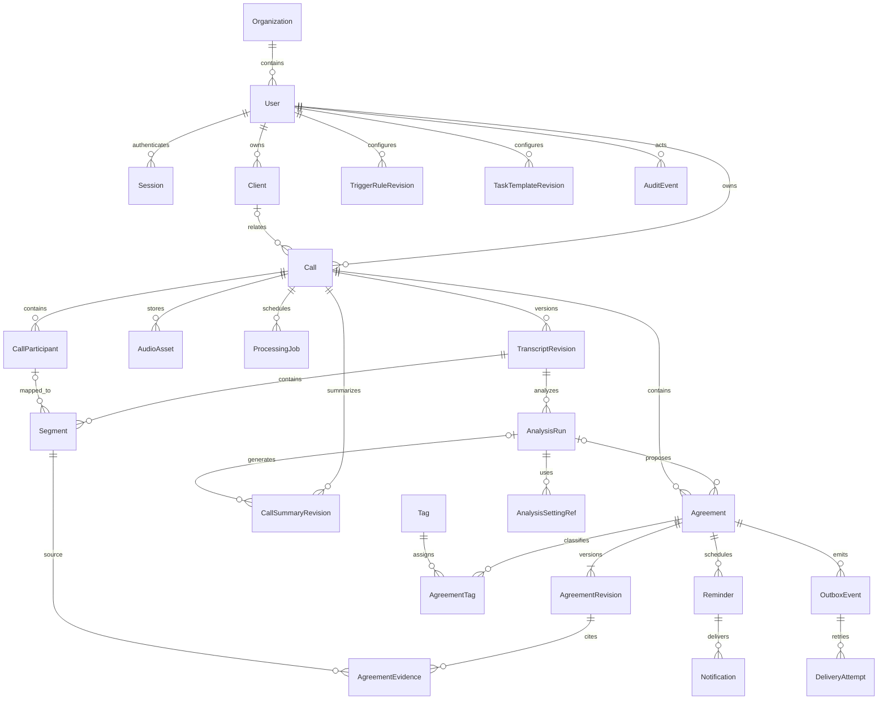

# Предметная модель и переходы

Версия 1.0, 14 октября 2026 года. Это проект предметной БД этапа 3 и далее.
На этапе 2 бизнес-таблицы, авторизация и очередь заданий не реализованы.
Техническая bootstrap-миграция не означает реализации приведённой ERD.

## 1. Соглашения

- Идентификаторы — UUID, время создания/изменения — timezone-aware UTC timestamps.
  API передаёт RFC 3339. `call_at` обязателен с offset, `timezone` — IANA имя.
- Business-таблицы имеют `organization_id`, `owner_id`; связи не пересекают владельцев
  или организации. Foreign keys и проверки сервиса действуют одновременно.
- Бизнес-правка повышает целую `version` через optimistic locking. Переход/правка,
  audit и outbox атомарны. Защита версий не заменяет проверку владельца.
- Удаляемые ресурсы имеют tombstone/retention; идентификатор удалённой записи не
  переиспользуется. Immutable — запрет перезаписи, а не запрет удаления.
- `Task` — API-представление Agreement, где `verification=accepted`.
- Provenance разделяет `fixture`, `manual`, будущие `asr/model`; demo хранится отдельно.

## 2. Первичная ERD



Кардинальность `Client` необязательна: звонок допустим без карточки клиента.
Segment с неизвестным speaker не связан с CallParticipant. Полиморфные audit
и settings references здесь упрощены; точные FK/индексы фиксируются миграциями.

## 3. Сущности и поля

Общие `id`, `organization_id`, `owner_id`, `created_at`, `updated_at`, `version`
опущены там, где повторяются. Immutable revisions имеют свой id и sequential
revision number; current pointers находятся на агрегатах.

| Сущность | Основные поля и смысл | Ограничения |
|---|---|---|
| Organization | `name`, `status` | Будущая командная граница; доступ MVP остаётся owner-only |
| User | `organization_id`, `login`, `password_hash`, `is_active` | Никогда не выдаём hash; seed входа на этапе 3 |
| Session | `user_id`, `token_digest`, `expires_at`, `revoked_at`, `csrf_digest` | Храним digest; cookie/settings отдельно |
| Client | `display_name`, optional контакты/заметки | Контакт клиента не равен аккаунту приложения |
| Call | `client_id?`, `title`, `call_at`, `timezone`, `language`, `source`, `is_demo`, `processing_status`, `analysis_status`, `current_transcript_id?`, `current_summary_id?`, `deleted_at?` | Call принадлежит owner; date upload не служит fallback для относительных сроков |
| CallParticipant | `call_id`, `display_name?`, `role=manager/client/other/unknown`, `user_id?`, `client_id?`, `identity_state` | speaker отдельно; внешнее лицо не получает User автоматически |
| AudioAsset | `call_id`, `kind=original/derived`, `storage_key`, `mime`, `sha256`, `size_bytes`, `duration_ms?`, `channels?`, `retention_until`, `availability` | Приватный key, не URL; временная шкала исходника сохранена |
| ProcessingJob | `call_id`, `stage`, `status`, `input_revision_id?`, `attempt`, `max_attempts`, `not_before`, `lease_token?`, `lease_until?`, `heartbeat_at?`, `error_code?` | Unique logical stage+input; short transactions; реализация этапа 5 |
| TranscriptRevision | `call_id`, `revision`, `source`, `provider_version?`, `parent_revision_id?`, `retention_until`, `availability` | Append-only; не смешиваем fixture с реальным ASR |
| Segment | `transcript_revision_id`, `position`, `speaker_id?`, `participant_id?`, `text`, `start_ms?`, `end_ms?` | Unique revision+position; оба времени либо null, либо 0≤start≤end |
| AnalysisRun | `call_id`, `transcript_revision_id`, `status`, `source`, `provider_version?`, `settings_snapshot`, `started_at?`, `finished_at?`, `error_code?` | Не изменяет принятые Agreement; model runtime не зафиксирован |
| Agreement | `call_id`, `analysis_run_id?`, `current_revision_id`, `verification`, `execution`, `source`, `accepted_at?` | Принятие выполняет user; никакого отдельного Task дубля |
| AgreementRevision | `agreement_id`, `version`, `action`, `obligor_participant_id?`, `recipient_participant_id?`, `due`, `condition?`, `needs_details`, `priority`, `confidence`, `manual_confidence_override?`, `change_reason?` | История правок/состояний; action 1..2000 символов; old version не перезаписывается |
| AgreementEvidence | `agreement_revision_id`, `transcript_revision_id`, `segment_id`, `start_cp`, `end_cp`, `quote`, `context?`, `start_ms?`, `end_ms?`, `availability` | Quote = slice segment; диапазон [start,end) в code points; поля удаляются по text-retention |
| CallSummaryRevision | `call_id`, `revision`, `analysis_run_id?`, `summary`, `client_message_draft`, `source`, `parent_id?`, `retention_until` | Текст для копирования; никаких автоматических отправок клиенту |
| Tag / AgreementTag | `name`, `color?`; join `agreement_id/tag_id` | Unique owner+normalized name; tags одной принадлежности |
| TaskTemplateRevision | `template_id`, `revision`, `name`, `default_priority`, `default_tags`, `reminder_policy` | Версионированный пользовательский шаблон |
| TriggerRuleRevision | `rule_id`, `revision`, `phrase`, `enabled`, `kind` | Конфигурация извлечения; текущая эффективность не заявлена |
| AnalysisSettingRef | `analysis_run_id`, `kind`, `revision_id` | Использованная конфигурация immutable/snapshot |
| Reminder | `agreement_id`, `agreement_version`, `scheduled_at`, `status`, `recipient_user_id` | Active только для accepted open/in_progress и доступных данных |
| Notification | `reminder_id?`, `user_id`, `kind`, `created_at`, `read_at?` | Unique delivery key; текст без копий истёкших источников |
| OutboxEvent | `aggregate_id`, `aggregate_version`, `event_type`, `payload`, `status`, `deduplication_key` | В транзакции с aggregate; содержит минимум данных и собственную retention |
| DeliveryAttempt | `event_id`, `attempt`, `started_at`, `result`, `retry_at?`, `response_code?` | Не логируем secrets или полное тело |
| AuditEvent | `actor_id?`, `entity_type`, `entity_id`, `operation`, `request_id`, `changed_fields` | Метаданные вместо расшифровок/паролей/аудио |

Индексы будущего этапа: `(owner_id,created_at,id)` Call;
`(owner_id,verification,execution,due_*)` Agreement; `(status,not_before)` jobs;
`(status,scheduled_at)` reminders; `(status,not_before)` outbox; unique
`(owner_id,operation,idempotency_key)` запросов. Exact due indexes определяются
фактической формой due storage на этапе 3.

## 4. Срок, неизвестность и confidence

Дискриминированный `Due` в API:

```json
{
  "kind": "date_only",
  "date": "2026-10-17",
  "timezone": "Europe/Minsk",
  "original_text": "до 17 октября 2026",
  "basis_call_at": "2026-10-14T10:00:00+03:00",
  "normalization_source": "manual",
  "ambiguous": false,
  "ambiguity_reasons": []
}
```

| kind | Значимые поля | Правило |
|---|---|---|
| `date_only` | `date`, `timezone` | Дата без выдуманного времени |
| `instant` | `at`, `timezone` | Timestamp с offset |
| `interval` | `start`, `end`, `timezone` | Обе границы timestamp, start≤end |
| `unknown` | `original_text?`, reasons; `date/at/start/end` отсутствуют | Нет надёжного срока либо нужна проверка |

Не относящиеся к kind поля отсутствуют; неизвестный срок — объект `kind=unknown`,
а не пустая строка. Существующие поля снабжаются `normalization_source=manual/fixture/model`.
Для любой относительной даты сохраняется basis. Отсутствующий `call_at` не заменяем
`today`; если импорт не знает дату, нормализация блокируется до уточнения.

«Через 3 дня» означает календарную дату call_at+3 в timezone звонка.
«Завтра» — следующий местный день. «До пятницы» в пятницу не определяет, какая
пятница имеется в виду. Год без явного контекста не угадывается; несуществующая
дата отклоняется. Срок до начала звонка требует пользовательской проверки.

Participant reference может быть null; `identity_state=unresolved` отличает
неизвестное имя от отсутствующего обязательства. «Анна подготовит» со слов другого
участника — кандидат с `needs_details`, а не принятая задача от имени Анны.

`confidence={value:0..1|null,source:fixture/model/unknown,calibration:null|id}` —
исходная оценка. `manual_confidence_override` отдельно. Confidence fixture —
демо-число; оно не доказывает вероятность правильности или качество модели.

## 5. Независимые состояния и переходы

### Обработка звонка и задания

`Call.processing_status`: `received → queued → preparing → transcribing → transcript_ready`.
Из queued/preparing/transcribing возможны `blocked`, `failed`, `cancelled`.
`blocked` означает, например, отсутствующий провайдер; ошибка не подменяет пустой успех.
`failed/blocked → queued` только явным retry при подходящей конфигурации.
У text-only demo нет AudioAsset; заранее заданная revision может перевести call
в `transcript_ready`, provenance остаётся fixture.

`ProcessingJob.status`: `queued → running → succeeded`; `running → retry_wait/failed/cancelled`;
`retry_wait → queued`; истёкший lease допускает повторный захват, если не исчерпаны attempts.
Удаление/retention отменяет очередь и лишает running права фиксации результата.
Прогресс стадии не равен прогрессу всего pipeline; не выдаём недоказанный процент.

`Call.analysis_status`: `not_connected`, `queued`, `running`, `ready`, `failed`, `cancelled`.
На этапе 2 провайдер disabled. Позже известный demo проходит queued/running/ready,
а произвольный call без провайдера остаётся not_connected с ручным режимом.

### Verification и execution договорённости

| Действие | Предусловия | Результат/эффекты |
|---|---|---|
| `accept` | proposed, актуальная version, проверены условия | accepted; execution=open; accepted_at; schedule/outbox |
| `reject` | proposed или accepted | rejected; future reminders отменены; отзыв внешним адаптерам |
| `unconfirm` | accepted | proposed; выполнение history сохраняется; task исчезает; отзыв |
| `save_and_confirm` | accepted, актуальная version | Новая accepted revision; schedule/outbox обновлены |
| `edit_proposal` | proposed/rejected | Новая proposed revision; нет task-effects |
| `start` | accepted + open | in_progress |
| `complete` | accepted + open/in_progress | done; reminders отменены; update outbox |
| `cancel` | accepted + open/in_progress | cancelled; reminders отменены; update outbox |
| `reopen` | accepted + done/cancelled | open; schedule пересчитано |

Принятие `rejected` происходит через `edit_proposal`/возврат proposed, затем accept.
Повтор уже выполненного перехода с прежней version даёт version_conflict; HTTP
повторы защищает отдельный Idempotency-Key там, где требуется атомарный replay.
Execution может сохраняться в history после unconfirm, но новый accept возвращает
open с явным подтверждением — завершение не возрождается молча.

### Источники и устаревание

`Evidence.availability`: `available`, `expired`, `deleted`. При новой расшифровке
старая revision сохраняется; UI получает `requires_recheck=true`, если текущий
текст отличается от используемого analysis/evidence. Отметка не снимает принятие
автоматически. Анализ новой revision порождает отдельные предложения.

Evidence offsets считаются по Unicode code points в `Segment.text`, 0-based,
конец исключён. Они не считаются по байтам, UTF-16 code units или графемам.
Например `А🌲Б`: диапазон `[1,2)` — `🌲`; в JavaScript нужна code-point конверсия.
Нормализация Unicode не применяется после расчёта spans. Quote и context удаляются
вместе с исходным текстом, чтобы retention нельзя было обойти копией цитаты.

## 6. Внутренняя граница будущего анализа

`AnalysisProvider` принимает immutable TranscriptRevision, participant mapping,
call_at/timezone и snapshot settings. Возвращаемая структура приложения включает
summary draft, список кандидатов, due/unknown reasons, confidence/provenance и evidence.
Вход/выход валидируется перед сохранением; provider не получает разрешение писать
в БД, подтверждать задачи, посылать CRM или изменять пользовательные данные.

Это интерфейс предметной логики, а не выбранный HTTP/OpenAI/local-server протокол.
На этапе 2 disabled-провайдер явно отклоняет вызов. Fixture-провайдер для известных
демо добавляется позже. Контракт конкретной модели, промпт и runtime уточняются
по результатам испытаний железа.
